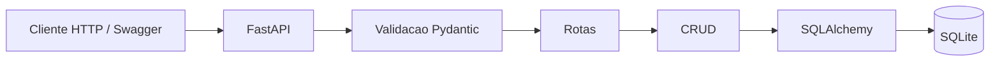

# API de Gerenciamento de Tarefas

API HTTP desenvolvida no Bootcamp para cadastrar, listar, editar, concluir e
excluir tarefas. Usa Python, FastAPI, Pydantic, SQLAlchemy e SQLite, com testes em
pytest e integração contínua no GitHub Actions.

Todas as tarefas pertencem a uma lista compartilhada. Cada registro possui
`id`, `titulo` e `concluida`. O escopo tem quatro operações HTTP, sem usuários,
autenticação, filtros, paginação ou reabertura de tarefas.

## Estado da Entrega Final

Atualização técnica: **27/10/2026**, sobre a `develop` em
[`668faae`](https://github.com/gabrielavieirab/tarefas-api/commit/668faae7bdc54024c1b7c75ca483aa9adfe21d8d).
Essa base incorpora a auditoria, as respostas 404 na documentação automática,
a cobertura no CI e a documentação inicial do PR #30 de Gabriela. A
[especificação As-Built](docs/especificacao-as-built.md) descreve a implementação.

A validação local terminou com **81 testes aprovados, um aviso de descontinuação
e 91% de cobertura de linhas de `app/`**. A
[CI da mesma base](https://github.com/gabrielavieirab/tarefas-api/actions/runs/40586231416)
concluiu os testes no runner, o build e os testes Docker com sucesso. O percentual
citado é local; ambientes, relatórios e limites estão nas
[evidências](docs/evidencias_testes.md).

O contrato da API continua em **1.1.0** e o pacote em **0.1.0**. A Release
**v1.0.0** é a identificação prevista para a entrega acadêmica, distinta dessas
versões. A coordenação da Release, do vídeo e do PDF final cabe a Gabriela;
esta conferência não substitui o fechamento e a aprovação da equipe.

## Equipe e responsabilidades na Entrega Final

- **Vitor de Assis Patricio Borges - RA 22304737:** especificação, README,
  arquitetura final, As-Built, ADRs e revisão técnica do PDF.
- **Gabriela Vieira Baptista - RA 22510133:** coordenação, Release, vídeo,
  relatório/PDF e submissão final.
- **Felipe Domingos Ribeiro Pereira - RA 22604250:** auditoria da implementação,
  correções e testes.
- **Caike Ribeiro Menezes - RA 22601978:** Docker, CI, cobertura e evidências.

## Instalação local

Use Python 3.12. O Docker e o CI usam **3.12.10**. A verificação local desta
atualização usou **3.12.6**; isso não substitui a execução no ambiente padronizado.

Na raiz do projeto, no PowerShell:

```powershell
python -m venv .venv
.\.venv\Scripts\Activate.ps1
python -m pip install -e ".[test]"
python -m pip check
```

Se a política do PowerShell impedir a ativação, use diretamente
`.\.venv\Scripts\python.exe` no lugar de `python`, sem mudar a política do sistema.
No Linux/macOS, crie o ambiente com `python3.12 -m venv .venv` e ative com
`source .venv/bin/activate`; os comandos seguintes são os mesmos.

As dependências principais estão fixadas em [pyproject.toml](pyproject.toml):
FastAPI 0.141.1, Uvicorn 0.52.4, Pydantic 2.13.5, SQLAlchemy 2.0.52,
pytest 9.1.1 e HTTPX 0.28.1. `pytest-cov` está incluído no extra `test` sem pin.
Ainda não há lock das dependências transitivas;
uma instalação futura pode resolver versões diferentes delas.

## Executar a aplicação

Com o ambiente virtual ativo, na raiz do projeto:

```powershell
python -m uvicorn app.main:app --reload
```

- API: <http://127.0.0.1:8000/tarefas>
- Swagger UI: <http://127.0.0.1:8000/docs>
- ReDoc: <http://127.0.0.1:8000/redoc>
- OpenAPI gerado pela aplicação: <http://127.0.0.1:8000/openapi.json>

A inicialização cria a tabela automaticamente. O banco padrão é `tarefas.db`,
no diretório de execução, e é reutilizado entre reinicializações. Para escolher
outro arquivo, defina a variável antes de iniciar o processo:

```powershell
$env:TAREFAS_DATABASE_URL = "sqlite:///./tarefas-local.db"
python -m uvicorn app.main:app --reload
```

O diretório do arquivo precisa existir. No PowerShell, use
`Remove-Item Env:TAREFAS_DATABASE_URL` para remover essa configuração da sessão.
O script opcional `python scripts/criar_banco.py` inicializa o banco sem subir
o servidor. Arquivos de banco não são versionados.

## Rotas e regras principais

- **POST `/tarefas` - 201:** recebe somente `titulo`; cria uma tarefa com
  `concluida=false` e ID gerado pelo banco.
- **GET `/tarefas` - 200:** retorna todas as tarefas por ID crescente;
  retorna `[]` quando a lista está vazia.
- **PATCH `/tarefas/{id}` - 200:** aceita `titulo`, `concluida: true` ou ambos.
  Preserva o ID e os campos omitidos. Editar uma tarefa concluída não a reabre.
- **DELETE `/tarefas/{id}` - 204:** exclui o registro e retorna corpo vazio.

Exemplos de corpos JSON para usar no Swagger:

```json
{"titulo": "  Estudar a API  "}
```

```json
{"titulo": "Revisar a API", "concluida": true}
```

O título deve ser texto com 1 a 120 caracteres após remover espaços das
extremidades. Campos extras, tipos inválidos, PATCH vazio e `concluida: false`
retornam **422**, sem alterar os dados. IDs devem ser inteiros positivos até
`9223372036854775807`; IDs inválidos retornam **422**. Um ID válido inexistente,
com entrada válida, retorna **404** e `{"detail":"Tarefa não encontrada."}`.

Use o ID retornado pelo cadastro: não há garantia de sequência sem lacunas ou
de que o primeiro ID de qualquer banco será 1. O contrato completo está na
[especificação SDD](docs/especificacao_sdd.md).

## Testes automatizados

```powershell
python -m pytest tests -v --junitxml=test-results/pytest.xml
```

A indicação de `tests` limita a coleta à suíte oficial, inclusive em cópias de
trabalho com arquivos temporários. Em um checkout limpo, `pytest` também coleta
a suíte. Os testes usam SQLite temporário e substituem a dependência de sessão;
verificam inclusive que o banco manual não é acessado nem alterado.

Há cenários de cadastro, listagem, edição, conclusão, exclusão, validação,
limites, persistência entre processos e isolamento. **81 testes aprovados**
significa que todos os casos executados passaram; não é uma medição de 100%
de cobertura do código. A rastreabilidade está nos
[critérios de aceitação](docs/criterios_aceitacao.md).

Para medir cobertura e salvar o XML:

```powershell
python -m pytest tests -v --cov=app --cov-report=term-missing --cov-report=xml:test-results/coverage.xml --junitxml=test-results/pytest.xml
```

Na execução local de 27/10/2026, 135 de 148 instruções foram cobertas (91%
arredondados no terminal). A medição é de linhas, sem cobertura de branches.
Os caminhos não medidos estão registrados nas evidências.

## Docker e persistência

Com o Docker disponível, execute na raiz:

```powershell
docker build -t tarefas-api:local .
docker volume create tarefas-dados
docker run --rm --name tarefas-api -p 127.0.0.1:8000:8000 -v tarefas-dados:/data tarefas-api:local
```

O container usa Python 3.12.10, Uvicorn na porta 8000 e
`TAREFAS_DATABASE_URL=sqlite:////data/tarefas.db`. O volume `tarefas-dados`
mantém o banco ao recriar o container. Acesse o Swagger pelo mesmo endereço
local indicado acima. Encerre o processo com `Ctrl+C` antes de reutilizar a porta.

Para executar a suíte dentro da imagem, sem iniciar o servidor:

```powershell
docker run --rm tarefas-api:local python -m pytest tests -v
```

Para medir a cobertura no container e salvar os relatórios no PowerShell:

```powershell
New-Item -ItemType Directory -Path test-results -Force | Out-Null
docker run --rm -v "${PWD}/test-results:/resultados" tarefas-api:local python -m pytest tests -v --cov=app --cov-report=term-missing --cov-report=xml:/resultados/coverage-docker.xml --junitxml=/resultados/docker.xml
```

Os testes usam bancos temporários e não precisam do volume da aplicação.
O build e os testes no container foram confirmados na execução pública de CI
referenciada acima; Docker não estava disponível no ambiente local desta atualização.

## Arquitetura



O FastAPI valida a entrada antes de executar a função da rota. No diagrama,
o acesso ao SQLite representa tanto leitura quanto escrita: GET consulta os
registros sem alterá-los e sem executar `commit`; POST, PATCH e DELETE criam,
atualizam e excluem registros, respectivamente, e o CRUD confirma essas escritas
com `commit` antes do retorno de sucesso. PATCH e DELETE também consultam o
registro pelo ID antes de alterá-lo; se ele não existir, a rota retorna 404.
Consulte a [arquitetura detalhada](docs/arquitetura.md) para os módulos,
o ciclo de sessão e o fluxo de resposta.

## Integração contínua e revisão

O [workflow de testes](.github/workflows/tests.yml) roda nos PRs para `develop`
e `main` e nos pushes nessas branches. Ele instala o projeto, executa `pip check`,
roda pytest com cobertura, constrói a imagem e testa com cobertura no container.
Os relatórios `pytest.xml`, `docker.xml`, `coverage.xml` e `coverage-docker.xml`
são publicados no artefato `resultados-testes`. Não há deploy automático.

O fluxo da equipe é Issue, branch de trabalho, commits, PR para `develop`,
revisão por outro integrante, CI e integração. A publicação estável passa por
PR de `develop` para `main`. Para a documentação de Vitor, Felipe é o revisor
principal e Gabriela verifica clareza e aderência à atividade.

Integrações já realizadas:

- [PR #12](https://github.com/gabrielavieirab/tarefas-api/pull/12): especificação e decisões técnicas.
- [PR #14](https://github.com/gabrielavieirab/tarefas-api/pull/14): implementação da API e banco.
- [PR #15](https://github.com/gabrielavieirab/tarefas-api/pull/15): testes, Docker e CI.
- [PR #16](https://github.com/gabrielavieirab/tarefas-api/pull/16): documentação e evidências funcionais.
- [PR #17](https://github.com/gabrielavieirab/tarefas-api/pull/17): integração da entrega inicial em `main`.
- [PR #25](https://github.com/gabrielavieirab/tarefas-api/pull/25): documentação técnica da entrega 2.
- [PR #26](https://github.com/gabrielavieirab/tarefas-api/pull/26): documentação de 404 e teste explícito de PATCH vazio.
- [PR #29](https://github.com/gabrielavieirab/tarefas-api/pull/29): auditoria final.
- [PR #30](https://github.com/gabrielavieirab/tarefas-api/pull/30): base As-Built e retrospectiva.

## Documentação

- [Especificação SDD](docs/especificacao_sdd.md): escopo, requisitos e contratos.
- [Especificação As-Built](docs/especificacao-as-built.md): implementação conferida e diferenças do planejamento.
- [Arquitetura e fluxo](docs/arquitetura.md): diagrama e componentes implementados.
- [Decisões técnicas](docs/decisoes_tecnicas.md): ADRs, justificativas e limitações.
- [Contrato OpenAPI estático](docs/openapi.json): contrato de aceitação versionado.
- [Critérios de aceitação](docs/criterios_aceitacao.md): cenários e vínculo com a suíte.
- [Refinamentos](docs/refinamentos.md): evolução da especificação e evidências.
- [Entrega Final de Vitor](docs/entrega3_vitor.md): entregáveis, parecer técnico e pendências.
- [Roteiro de Vitor para o vídeo](docs/roteiro-video-vitor.md): arquitetura e documentação em 45 a 60 segundos.
- [Contribuição anterior de Vitor](docs/entrega_vitor.md): histórico da etapa 2.
- [Relato técnico de Vitor](docs/relato_experiencia_vitor.md): texto para a comunicação técnica do relatório.
- [Revisão da análise de IA](docs/revisao_ia_vitor.md): parecer assistido e contribuição factual de Vitor.
- [Análise crítica de IA](docs/analise-critica-ia.md): texto de Gabriela em consolidação.
- [Governança da entrega 2](docs/governanca-entrega2.md): organização e critérios do grupo.
- [Evidências de testes e CI](docs/evidencias_testes.md): execuções e limites da validação.
- [Evidências da entrega inicial](evidencias/README.md): registros visuais já publicados.

O OpenAPI estático detalha regras que os validadores personalizados implementam.
O esquema gerado em `/openapi.json` já declara os 404 de PATCH/DELETE, mas ainda
não expõe todas as restrições dos validadores; os dois arquivos não são idênticos.
A especificação e os testes complementam a consulta ao Swagger. A conferência
OpenAPI descrita nas evidências é adicional à suíte automatizada.
