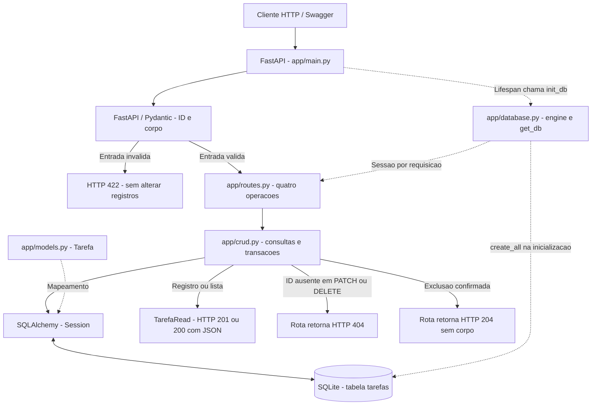

# Arquitetura e fluxo da aplicação

Atualização: 27/10/2026. Descreve a implementação integrada na base `668faae`,
mantendo o contrato 1.1.0 da [especificação SDD](especificacao_sdd.md).
As justificativas estão nos [ADRs](decisoes_tecnicas.md), e o estado final está
na [especificação As-Built](especificacao-as-built.md).

## Diagrama final

O [fonte Mermaid](diagramas/arquitetura-final.mmd) permite reutilizar o diagrama
no relatório e na apresentação. As setas tracejadas representam configuração,
mapeamento ou inicialização; as contínuas representam o fluxo da requisição.

O diagrama representa as responsabilidades da aplicação; não detalha a ordem
interna de resolução de cada dependência do FastAPI. A função da rota recebe
ID e corpo já validados. Criar uma sessão não implica consultar ou alterar
um registro antes da validação. A saída do CRUD passa pela função da rota:
ela serializa o objeto/lista ou transforma ausência em erro 404. As escritas
fazem `commit` antes do sucesso; GET apenas consulta, sem `commit`.

## Componentes implementados

- **`app/main.py`:** cria o FastAPI, registra o router e usa `lifespan` para
  inicializar as tabelas ao iniciar a aplicação.
- **`app/database.py`:** lê `TAREFAS_DATABASE_URL`, cria o engine e a fábrica
  de sessões e fornece `get_db()`. Cada requisição recebe uma sessão, fechada
  em `finally`. `init_db()` importa os modelos antes de criar as tabelas.
- **`app/models.py`:** declara `Tarefa`, com chave primária `id`,
  `titulo` obrigatório e `concluida` inicialmente falsa.
- **`app/schemas.py`:** valida e normaliza o título, rejeita campos extras,
  exige pelo menos um campo no PATCH e aceita apenas `true` para conclusão.
  `TarefaRead` serializa os três campos a partir do objeto ORM.
  `TarefaNaoEncontrada` descreve o 404 e fornece a mensagem usada pelas rotas.
- **`app/routes.py`:** expõe as quatro operações, valida o intervalo do ID
  e transforma ausência em `HTTPException(404)`. PATCH e DELETE declaram o
  schema desse erro no OpenAPI; validadores de entrada ainda exigem a leitura
  do contrato detalhado, pois seus metadados não são completos no Swagger.
- **`app/crud.py`:** cria, lista por ID, busca, atualiza campos enviados e
  exclui registros. Escritas fazem `commit`; em falha de commit, fazem
  `rollback` e propagam o erro. Cadastro e atualização fazem `refresh`.
- **`scripts/criar_banco.py`:** permite criar as tabelas sem iniciar o servidor,
  usando a mesma configuração de banco.

## Inicialização, banco e testes

A URL padrão é `sqlite:///./tarefas.db`, relativa ao diretório de execução.
A variável de ambiente deve ser definida antes de importar/iniciar a aplicação,
pois a configuração e o engine são construídos no carregamento do módulo.
No Docker, a URL aponta para `/data/tarefas.db`; o volume em `/data` preserva
os dados entre containers.

`tests/conftest.py` configura um banco temporário antes de importar a aplicação,
protegendo também a inicialização via `lifespan`. A fixture de cliente cria um
SQLite limpo por teste, substitui `get_db`, restaura os overrides, fecha o engine
e remove o arquivo. Os testes de isolamento verificam isso em processos
independentes; o teste de persistência reinicia a aplicação com o mesmo arquivo
temporário para conferir o estado salvo.

## Limites e escolhas

Há uma aplicação com acesso síncrono ao banco, uma tabela e uma lista
compartilhada. Não há camada genérica de serviços, servidor de banco separado
ou migrações de esquema. `create_all()` cria tabelas ausentes; não representa
um processo de evolução de tabelas existentes.

Essa estrutura atende à demonstração acadêmica local. Autenticação,
concorrência de múltiplos servidores e requisitos de produção exigiriam nova
especificação e avaliação arquitetural. O build Docker e os testes no container
são executados no CI; a persistência por volume deve ser conferida também
na validação operacional da equipe.
